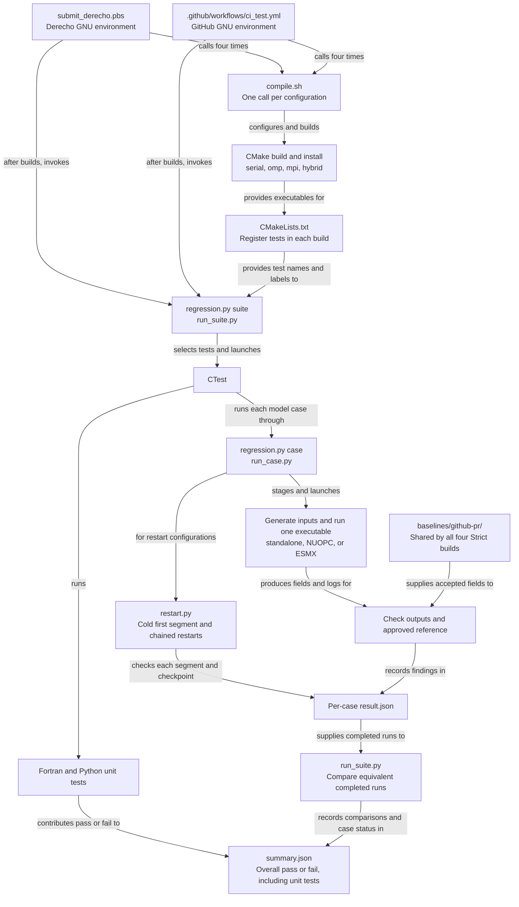
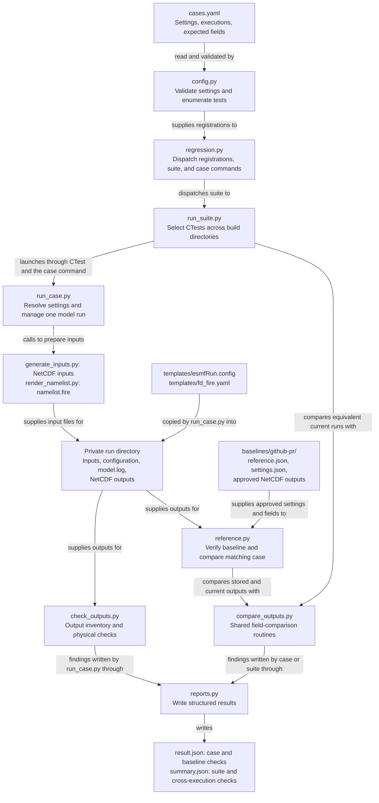

# Structure and execution

[Documentation index](../README.md)

These diagrams show the main execution and data relationships. They group model
executables, generated artifacts, and baseline files rather than listing every
file in those directories. Paths are relative to `tests/regression/` unless
shown otherwise. Arrows state what one file or step does with the next.

## Execution overview

The PBS template and GitHub workflow each build four configurations, then run
one PR suite across their build directories. **Each call to `compile.sh` builds
one configuration.** Python selects and checks tests; it does not compile the
model.

The complete PR matrix has 36 model runs, 40 cross-execution comparisons, and
36 approved-baseline comparisons, plus unit tests. In contrast,
`compile.sh --openmp-on --esmx --test-suite=pr` builds only hybrid and then
invokes the suite for that build: four standalone, two NUOPC, and two ESMX
runs. `--esmx` enables both coupled drivers while retaining standalone.

Strict selects the shared baseline automatically. `--reference` overrides it;
`--no-reference` disables historical comparison with a warning. Physical and
cross-execution checks remain active. See [running tests](running.md) for
commands and [comparison rules](comparison.md) for acceptance criteria.

The separately selected [restart suite](restart.md) uses `run_case.run_model`
for the continuous run and every segment. `restart.py` copies the original
forcing, derives segment namelists, and calls the shared comparison routines.
Its results enter the same case and suite reports; it does not build or launch
tests through a second framework.

## File relationships inside the harness

`regression.py` is the command interface. CMake uses its `registrations` command
when configuring tests; CTest uses its `case` command when running a model case.
The PBS template and workflow use its `suite` command to select tests across
builds and combine their results. `run_case.py` also uses `config.py` to resolve
the selected scientific settings; `run_suite.py` reads comparison settings
through the same module. The diagram groups related files to keep it readable.

`run_suite.py` reads the completed `result.json` files before comparing runs
and writing `summary.json`. `run_case.py` also writes `esmxRun.yaml` from the resolved clock, MPI rank count,
and coupling sequence. `generate_inputs.py` writes the input files directly;
`run_case.py` saves the rendered namelist and preserves inputs, logs, and outputs
alongside `result.json`, including when a case fails.

There are two uses of `compare_outputs.py`: `reference.py` compares a run with
its stored baseline; `run_suite.py` compares equivalent runs from the current
suite. A suite compares only matching case, configuration, and scale. It never
compares `u10m` against `u3d` or WENO against Godunov. It prefers standalone
serial when available, then the smallest available rank/thread layout. A
partial selection establishes agreement only among the selected runs. Failed
cases remain failures when a dependent comparison cannot be performed.

Reference generation is a separate, explicit operation:
`regression.py reference-create` calls `reference.py` to read a passing suite's
reports and copy its settings and NetCDF outputs into a new **unapproved**
candidate. Normal test execution never refreshes the approved baseline. See
[reference review and activation](references.md#github-review-and-activation).

## Files and responsibilities

| File | Responsibility |
| --- | --- |
| [submit_derecho.pbs](../submit_derecho.pbs), [ci_test.yml](../../../.github/workflows/ci_test.yml) | Build four configurations and invoke the PR suite |
| [compile.sh](../../../compile.sh) | Configure, build, and install one selected configuration per call |
| [regression.py](../regression.py) | Parse public commands and dispatch |
| [config.py](../config.py), [cases.yaml](../cases.yaml) | Resolve settings, validate supported options, enumerate tests |
| [CMakeLists.txt](../CMakeLists.txt) | Choose executables, launcher, labels, timeouts, processor counts |
| [run_case.py](../run_case.py) | Stage and execute one existing binary |
| [generate_inputs.py](../generate_inputs.py) | Construct deterministic NetCDF input fields |
| [render_namelist.py](../render_namelist.py) | Write exact namelist options; derive dates and input geometry |
| [check_outputs.py](../check_outputs.py) | Check output inventory, metadata, forcing, and fire evolution |
| [compare_outputs.py](../compare_outputs.py) | Compare every saved field and report spatial errors |
| [run_suite.py](../run_suite.py) | Select CTests and compare equivalent completed cases |
| [reports.py](../reports.py) | Save structured results and print their locations |
| [reference.py](../reference.py) | Create unapproved references and verify supplied references |
| [python_harness_test.py](../tests/python_harness_test.py), [generator_comparator_test.py](../tests/generator_comparator_test.py) | Test the Python infrastructure using generated inputs and synthetic arrays |
| [tests/unit/](../../unit/) | Fortran unit tests, registered separately from model cases |
| [baselines/github-pr/](../baselines/github-pr/README.md) | Approved settings and output fields shared by all four builds |
| [legacy/](../../legacy/README.md) | Preserve historical fixtures and comparisons |

The model or coupler selects MPI decomposition from its communicator. Runtime
rank/thread settings are separate from compilation. Namelist `num_tiles` and
`tile_strategy` control within-rank tiling. CTest reserves ranks × threads and
the PBS template runs CTest cases sequentially within the allocation.

The archived [legacy tests](../../legacy/README.md) use a separate build route
and are not run by the PBS template or GitHub workflow. Documentation files,
case figures, and `doc/plot_cases.py` explain the tests but are not part of
model execution.
